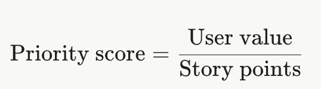

# Overview

Use this section to present the product vision, which is a clear statement of the overall goal and purpose of the product—what it aims to achieve, why it exists, and the target audience. Include a **use case diagram** that illustrates the main user interactions. This will give readers a clear and comprehensive overview of the project.

# User Stories

Describe the **user stories** for the project, which are short, simple descriptions of a feature told from the perspective of the end user. Each **user story** should include clear **acceptance criteria** and a **point estimate**. The **user stories** must align with the **use case diagram** and should be labeled as US#1, US#2, and so on. 

Use the following template when writing your **user stories**. 

```
As a [type of user], I want to [perform some task] so that I can [achieve some goal].

Acceptance Criteria

Given that [context],
When [action],
Then [expected outcome].
```

# Product Backlog

The backlog should have all user stories, including the ones that are optional. Assign a user value to each story using the following scale:

3 = High value
2 = Medium value
1 = Low value

Describe dependencies between user stories using their IDs (for example, US3 depends on US1). Fill out the table below. 

| ID | Rank | User value | Story Points | Priority Score | Depends on | Type 
| --- | --- | --- | --- | --- | --- | --- |
| US1 | — | 1-3 | — | — | — | Required/Optional |

Use the Fibonacci sequence for story point estimates (1, 2, 3, 5, 8, 13).

Compute the Priority Score as:



The Priority Score is intended as a planning aid. 

You may adjust the ranking when dependencies require a lower-ranked story to be completed first.

# Sprint Planning 

Sprint 0 is reserved for project planning activities such as defining the product vision, creating user stories, estimating story points, prioritizing the backlog, creating UML diagrams, setting up the repository, and configuring the development environment. No implementation work should be scheduled during Sprint 0.

After the planning phase (Sprint 0), the project proceeds through 2-3 one-week sprints, with each sprint ending in a tagged release (v1, v2, etc.).

Before writing any code, split the backlog across 2-3 sprints and record it below. Follow these rules:

* Capacity: set your team's capacity in story points per sprint and justify it in one or two sentences (team size, hours available, course load). No sprint may exceed it.
* Dependencies: a story can be in the same sprint as a story it depends on only if the plan shows the dependency finishing first; otherwise it goes in a later sprint.
* Required first: all required stories must be planned for the sprints. Optional stories are planned only in space left over.
* Priority: within those limits, higher-ranked stories go earlier.
* Planned burndown: list the story points remaining at the start and after each planned sprint. "Points remaining after sprint" refers to the total number of story points still remaining in the backlog after all stories planned for that sprint have been completed.

```
Team capacity (story points per sprint): <your team's capacity>

Justification (one or two sentences: team size, hours available, course load): <justification>
```

| Sprint | User stories (in order) | Story points planned | Points remaining after sprint | Dependencies checked (Y/N) |
| --- | --- | --- | --- | --- |
| Sprint 1 |  |  |  |  |
| Sprint 2 |  |  |  |  |
| Sprint 3 (optional) |  |  |  |  |
| **Total** |  |  |  |  |

# Sequence Diagram

At least one implemented user story, unrelated to user registration or authentication, must be documented using a sequence diagram. A **sequence diagram** is a type of UML diagram that shows how objects interact in a particular scenario, emphasizing the order of messages exchanged between components over time. This helps visualize the flow of operations and the responsibilities of different parts of the system.

# Model 

Include a **class diagram** that clearly describes the **model classes** used in the project and their associations. A **class diagram** is a UML diagram that represents the structure of the system by showing its classes, their attributes, methods, and the relationships between them (such as inheritance, aggregation, or composition). This helps visualize how the data and logic are organized within the application.

The class diagram should include only the model/domain classes. Do not include framework classes, library classes, controllers, routes, test classes, or utility classes unless they are central to the domain model.

# Development Process

Track all project tasks using GitHub Projects, Microsoft Teams, or another project management tool of your choice.

* Use at least these columns: To Do, In Progress, In Review, Done.
* Each user story should be represented by one or more GitHub Issues. Issue numbers should be referenced in commits and pull requests whenever applicable. If an issue is linked to a particular user story, reference it by its name. If an issue supports a particular user story, include the user story identifier in the issue title using the format US1: Description.
* Move cards as work progresses, not all at once at the end of the sprint.
* At the end of each sprint, add a screenshot of the board to the scrum folder (for example scrum/sprint_#/board.png).
* Embed the latest burndown chart image below.

The burndown chart should display:

* Sprint dates on the x-axis
* Remaining story points on the y-axis
* An ideal burndown line
* The actual burndown line

As in Project 2, you should take notes on the major Scrum meetings: planning, daily scrums, review, and retrospective. These meetings are essential for tracking progress, identifying obstacles, and ensuring continuous improvement. Use the Scrum folder and the shared templates to record your notes in an organized and consistent manner.

# Testing 

In this section, share the results of the tests performed to verify the quality of the developed product, including the test coverage relative to the written code. Test coverage indicates how much of your code is exercised by tests, helping assess reliability. 

There is no minimum coverage requirement. However, clearly identify and describe at least one white-box test and one black-box test, and report the overall test coverage generated by Python's coverage tool.

# Deployment 

Provide clear instructions for running your web application using Docker commands.
